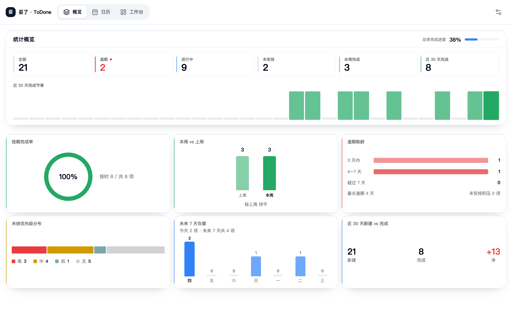
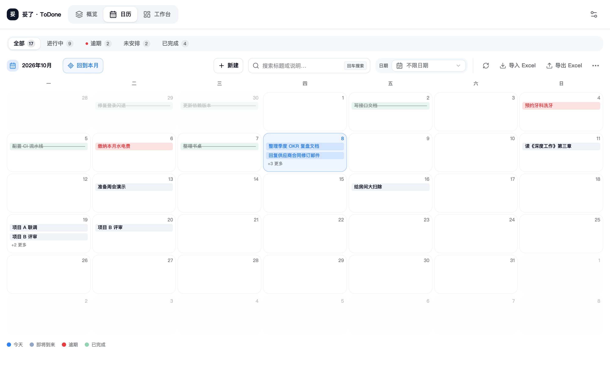
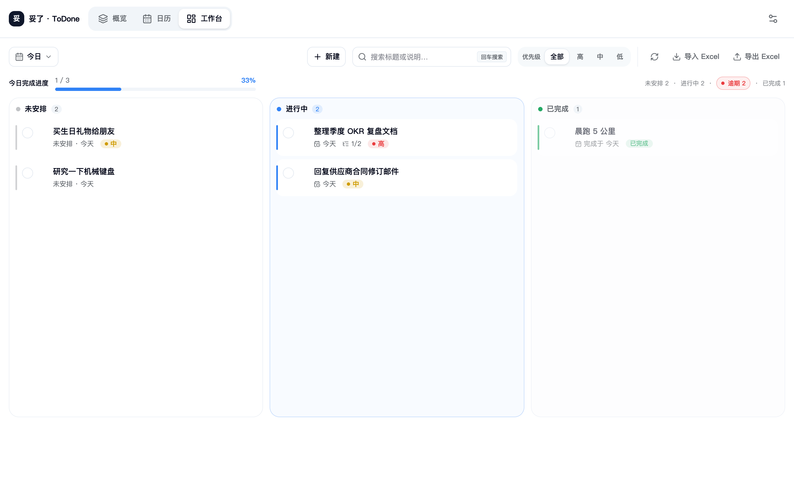

<p align="center">
  
</p>

<h1 align="center">Tuole (妥了 · ToDone)</h1>

<p align="center">A local-first to-do app that lives by dates: calendar scheduling, overdue tasks that never vanish, and data that stays on your machine.</p>

<p align="center">
  <a href="README.zh-CN.md">简体中文</a>&nbsp;&nbsp;|&nbsp;&nbsp;English
</p>

<p align="center">
  
  
  
  <a href="LICENSE"></a>
  
  
</p>

## Highlights

| Highlight | Why it matters |
|---|---|
| Fully local, works offline | No account, no cloud, no upload; browser data stays in browser storage, desktop data lives as readable JSON under `~/.tuole/` |
| Everything organized by date | Schedule on the calendar, focus a day in the workbench, see the big picture in the overview — three views over the same tasks |
| Overdue tasks never disappear silently | Missed items stay visible until you reschedule or finish them — the backlog is always in front of you |
| Rolling snapshots before any destructive action | Auto backup keeps the last 10 snapshots; replaces and imports always save a recovery point first |
| Daily reminder with nothing to configure beyond a time | One notification moment per day for "due today" and "overdue" tasks, delivered even without notification permission (in-app toast and sound) |

## Screenshots

**Overview** — totals, 30-day completion rhythm, and the full filterable list:



**Calendar** — a month grid you drag to navigate; unscheduled tasks sit in their parked day:



**Workbench** — one focused day across Unscheduled / In progress / Done, with the overdue tray on demand:



## Quick Install

Requirements: Node.js 18+ and [pnpm](https://pnpm.io).

```bash
git clone https://github.com/zs2731070169-web/tuole.git
cd tuole
pnpm install
```

- **Web**: `pnpm dev`, then open http://localhost:3015
- **macOS desktop**: `pnpm desktop:dist`, then run `desktop-release/mac-arm64/妥了.app` (Apple Silicon)

## Quick Start

1. Open the app — you land on **Overview**.
2. Switch to **Workbench**, click **New task**, type a title (required, marked with a red asterisk), optionally add **tags** or **to-dos**, and save. The task appears as *Unscheduled*.
3. Click **Schedule** on the task row to park it on the selected day — the moment its date arrives, the **Done** button appears automatically.
4. Miss a date? The task turns red as *Overdue* and stays until you reschedule it or mark it done.

## Task status at a glance

Status is computed from dates — no manual upkeep, and the Done button appears once the day arrives:

| Status | Meaning |
|---|---|
| Unscheduled | No date chosen yet — the default after creating a task |
| Upcoming | Scheduled for a future day |
| Today | The scheduled day has arrived |
| Overdue | The day passed without completion — it stays until you handle it |
| Done | Finished via the Done button or a drop on the Done column |

## The three views

| View | Use it to |
|---|---|
| **Overview** | See the whole picture: totals, this week and last 30 days, completion rhythm chart, and the paginated full list |
| **Calendar** | See the month: drag the grid to change months, hover the "+N more" entry for a day's full list, click a day twice to jump into it |
| **Workbench** | Focus one day: drag tasks between columns to schedule, finish, or unschedule; open the overdue panel from the top-right counter |

Deleting is always confirmed: per-task from the row action, in batch via checkboxes, or by selecting days in Calendar's delete mode.

## Daily reminder

Enable it in Settings and pick a time (default 09:00). Once per day after that time, due-today and overdue tasks are announced — one notification per task per day. The desktop app uses system notifications; the browser uses an in-app toast with a sound, plus a system banner when permission is granted and the tab is in the background. The app must be running for reminders to fire.

## Your data

| Edition | Storage |
|---|---|
| Desktop (macOS) | `~/.tuole/` — plain JSON files (`tasks.json`, `settings.json`, `backups/`); copy the folder to migrate machines |
| Browser | Browser local storage, tied to the browser profile |

Nothing leaves the machine: no account, no sync, no telemetry.

## Backup and Excel

- **Auto backup**: optional, interval from 5 minutes to once a day, last 10 snapshots kept; produces nothing when there are no tasks
- **Restore**: from any snapshot in Settings, or from an exported JSON backup file; a recovery point is saved before any replace
- **Excel**: export to xlsx (tasks and to-dos sheets, tags included on the task sheet), import with merge or full-replace modes

## Preferences

Light, dark, or system theme; Chinese or English interface.

## License

[MIT](LICENSE)
